

  

<h3 align="center">🚀 Founder &amp; CEO of PALDYN</h3>

  <b>두려움 없는 실행자</b> 
  기술에 갇히지 않고, AI를 지렛대 삼아 필요한 걸 만들어 냅니다.

---

## 🤖 AI-Powered Workflow

  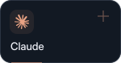
  
  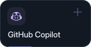
  
  

---

## 🧰 다뤄본 것들

  <b>Language</b> 
  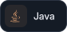
  
  
  
  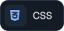

  <b>Backend</b> 
  
  
  
  
  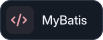

  <b>Database</b> 
  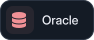
  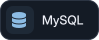
  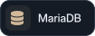
  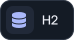

  <b>DevOps</b> 
  
  
  
  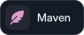
  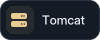

  <b>Collab / OS</b> 
  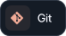
  
  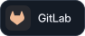
  
  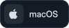

---

## 📊 GitHub 통계

  
  

### 3D Contribution City

  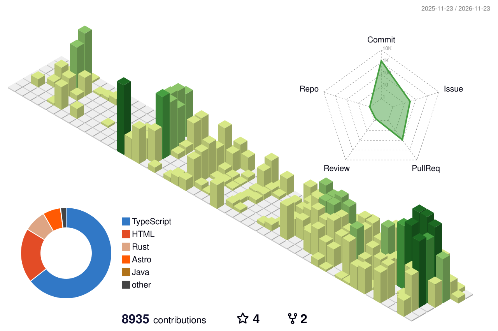

---

